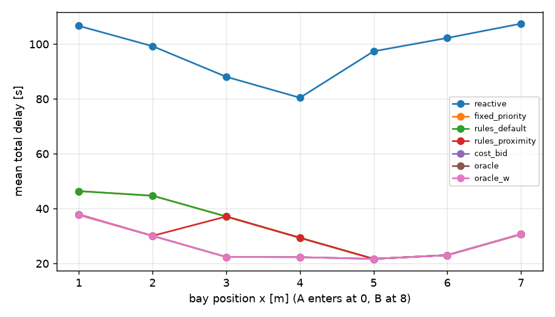
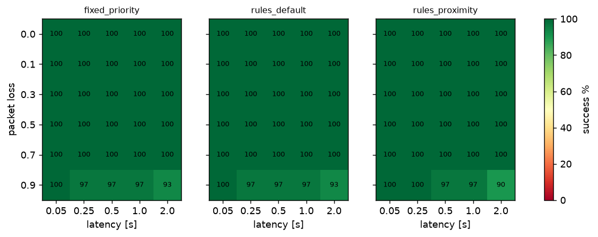

## S1 — Baseline comparison (single bay; bay x ∈ 1…7 m; B start delay U[0, 8] s; 60 seeds × 7 bay positions)

| Policy | success | deadlock | collision | total delay [s] | regret vs oracle [s] | same yielder as oracle | makespan [s] | reverse [m] | time to decide [s] | msgs | both yielded |
|---|---|---|---|---|---|---|---|---|---|---|---|
| `reactive` | 93.8% [91–96] | 6.2% [4–9] | 0.0% [0–1] | 97.1 ± 4.5 | 70.5 ± 4.5 | 50% | 112.6 ± 2.5 | 5.67 ± 0.32 | — | 0 | 39.3% [35–44] |
| `fixed_priority` | 100.0% [99–100] | 0.0% [0–1] | 0.0% [0–1] | 33.3 ± 0.9 | 6.4 ± 0.6 | 43% | 73.8 ± 1.1 | 0.95 ± 0.06 | 0.10 ± 0.00 | 745 | 0.0% [0–1] |
| `rules_default` | 100.0% [99–100] | 0.0% [0–1] | 0.0% [0–1] | 33.3 ± 0.9 | 6.4 ± 0.6 | 43% | 73.8 ± 1.1 | 0.95 ± 0.06 | 0.10 ± 0.00 | 745 | 0.0% [0–1] |
| `rules_proximity` | 100.0% [99–100] | 0.0% [0–1] | 0.0% [0–1] | 30.0 ± 0.6 | 3.1 ± 0.5 | 70% | 70.2 ± 0.6 | 0.65 ± 0.02 | 0.10 ± 0.00 | 709 | 0.0% [0–1] |
| `cost_bid` | 100.0% [99–100] | 0.0% [0–1] | 0.0% [0–1] | 26.8 ± 0.6 | 0.0 ± 0.0 | 100% | 69.6 ± 0.6 | 0.64 ± 0.02 | 0.10 ± 0.00 | 703 | 0.0% [0–1] |
| `oracle` | 100.0% [99–100] | 0.0% [0–1] | 0.0% [0–1] | 26.8 ± 0.6 | 0.0 ± 0.0 | 100% | 69.6 ± 0.6 | 0.64 ± 0.02 | 0.10 ± 0.00 | 703 | 0.0% [0–1] |
| `oracle_w` | 100.0% [99–100] | 0.0% [0–1] | 0.0% [0–1] | 26.8 ± 0.6 | 0.0 ± 0.0 | 100% | 69.6 ± 0.6 | 0.64 ± 0.02 | 0.10 ± 0.00 | 703 | 0.0% [0–1] |

Regret vs. oracle by bay position (mean s, successful episodes):

| label           |   1.0 |   2.0 |   3.0 |   4.0 |   5.0 |   6.0 |   7.0 |
|:----------------|------:|------:|------:|------:|------:|------:|------:|
| reactive        |  68.8 |  69.1 |  65.7 |  58.3 |  75.7 |  79.2 |  76.8 |
| fixed_priority  |   8.7 |  14.6 |  14.8 |   7.1 |   0   |   0   |   0   |
| rules_default   |   8.7 |  14.6 |  14.8 |   7.1 |   0   |   0   |   0   |
| rules_proximity |   0.2 |   0   |  14.8 |   7.1 |   0   |   0   |   0   |
| cost_bid        |   0   |   0   |   0   |   0   |   0   |   0   |   0   |
| oracle_w        |   0   |   0   |   0   |   0   |   0   |   0   |   0   |

## S5 — Fairness (from S1): who yields, and Jain index of the two robots' delays

| Policy | A yields | B yields | Jain(delay_A, delay_B) | mean delay A [s] | mean delay B [s] |
|---|---|---|---|---|---|
| `reactive` | 53% | 47% | 0.82 ± 0.01 | 52.0 | 45.0 |
| `fixed_priority` | 0% | 100% | 0.68 ± 0.02 | 5.8 | 27.4 |
| `rules_default` | 0% | 100% | 0.68 ± 0.02 | 5.8 | 27.4 |
| `rules_proximity` | 27% | 73% | 0.67 ± 0.02 | 13.9 | 16.1 |
| `cost_bid` | 57% | 43% | 0.57 ± 0.01 | 15.8 | 11.0 |
| `oracle` | 57% | 43% | 0.57 ± 0.01 | 15.8 | 11.0 |
| `oracle_w` | 57% | 43% | 0.57 ± 0.01 | 15.8 | 11.0 |

## S2 — Asymmetric robots (B: urgency 1|3, loaded no|yes, v_max 0.26|0.13 m/s; bay x ∈ {2,4,6}; 30 seeds)

Urgency-weighted delay Σ uᵢ·delayᵢ; regret is against the oracle that minimises the weighted delay (`oracle_w`).

| Policy | success | weighted delay [s] | regret vs oracle_w [s] | same yielder as oracle_w | B (urgent/loaded/slow) yields |
|---|---|---|---|---|---|
| `reactive` | 91.7% [89–93] | 131.2 ± 6.1 | 91.9 ± 6.0 | 50% | 50% |
| `fixed_priority` | 100.0% [99–100] | 66.5 ± 2.9 | 27.1 ± 2.6 | 36% | 100% |
| `rules_default` | 100.0% [99–100] | 43.0 ± 1.2 | 3.5 ± 0.4 | 64% | 25% |
| `rules_proximity` | 100.0% [99–100] | 42.7 ± 1.2 | 3.2 ± 0.4 | 65% | 34% |
| `cost_bid` | 100.0% [99–100] | 39.5 ± 1.1 | 0.0 ± 0.0 | 98% | 33% |
| `oracle` | 100.0% [99–100] | 46.5 ± 2.2 | 7.0 ± 1.5 | 86% | 50% |
| `oracle_w` | 100.0% [99–100] | 39.4 ± 1.1 | 0.0 ± 0.0 | 100% | 36% |

Regret vs. oracle_w by condition of robot B (mean s):

| label           |   u1.0 |   u1.0 loaded |   u1.0 loaded slow |   u1.0 slow |   u3.0 |   u3.0 loaded |   u3.0 loaded slow |   u3.0 slow |
|:----------------|-------:|--------------:|-------------------:|------------:|-------:|--------------:|-------------------:|------------:|
| reactive        |   66.5 |          66.5 |               57.1 |        57.1 |  139.1 |         139.1 |              102.9 |       102.9 |
| fixed_priority  |    7.1 |           7.1 |                2.5 |         2.5 |   40.6 |          40.6 |               58.2 |        58.2 |
| rules_default   |    7.1 |           4.9 |                7.7 |         2.5 |    2.9 |           2.9 |                0.1 |         0.1 |
| rules_proximity |    2.4 |           2.4 |                7.4 |         7.4 |    2.9 |           2.9 |                0.1 |         0.1 |
| cost_bid        |    0   |           0   |                0.1 |         0.1 |    0   |           0   |                0   |         0   |
| oracle          |    0   |           0   |                0   |         0   |    0   |           0   |               28.1 |        28.1 |

## S3 — Communication impairment (loss × latency; jitter 0.02 s; neg_timeout 3 s; 30 seeds)

**success rate [%]**

`fixed_priority` (rows = loss, cols = latency s)

|   comms.loss |   0.05 |   0.25 |   0.5 |   1.0 |   2.0 |
|-------------:|-------:|-------:|------:|------:|------:|
|          0   |    100 |    100 |   100 |   100 |   100 |
|          0.1 |    100 |    100 |   100 |   100 |   100 |
|          0.3 |    100 |    100 |   100 |   100 |   100 |
|          0.5 |    100 |    100 |   100 |   100 |   100 |
|          0.7 |    100 |    100 |   100 |   100 |   100 |
|          0.9 |    100 |     97 |    97 |    97 |    93 |

`rules_default` (rows = loss, cols = latency s)

|   comms.loss |   0.05 |   0.25 |   0.5 |   1.0 |   2.0 |
|-------------:|-------:|-------:|------:|------:|------:|
|          0   |    100 |    100 |   100 |   100 |   100 |
|          0.1 |    100 |    100 |   100 |   100 |   100 |
|          0.3 |    100 |    100 |   100 |   100 |   100 |
|          0.5 |    100 |    100 |   100 |   100 |   100 |
|          0.7 |    100 |    100 |   100 |   100 |   100 |
|          0.9 |    100 |     97 |    97 |    97 |    93 |

`rules_proximity` (rows = loss, cols = latency s)

|   comms.loss |   0.05 |   0.25 |   0.5 |   1.0 |   2.0 |
|-------------:|-------:|-------:|------:|------:|------:|
|          0   |    100 |    100 |   100 |   100 |   100 |
|          0.1 |    100 |    100 |   100 |   100 |   100 |
|          0.3 |    100 |    100 |   100 |   100 |   100 |
|          0.5 |    100 |    100 |   100 |   100 |   100 |
|          0.7 |    100 |    100 |   100 |   100 |   100 |
|          0.9 |    100 |    100 |    97 |    97 |    90 |

`cost_bid` (rows = loss, cols = latency s)

|   comms.loss |   0.05 |   0.25 |   0.5 |   1.0 |   2.0 |
|-------------:|-------:|-------:|------:|------:|------:|
|          0   |    100 |    100 |   100 |   100 |   100 |
|          0.1 |    100 |    100 |   100 |   100 |   100 |
|          0.3 |    100 |    100 |   100 |   100 |   100 |
|          0.5 |    100 |    100 |   100 |   100 |   100 |
|          0.7 |    100 |    100 |   100 |   100 |   100 |
|          0.9 |    100 |    100 |   100 |    97 |    93 |

**collision rate [%]**

`fixed_priority` (rows = loss, cols = latency s)

|   comms.loss |   0.05 |   0.25 |   0.5 |   1.0 |   2.0 |
|-------------:|-------:|-------:|------:|------:|------:|
|          0   |      0 |      0 |     0 |     0 |     0 |
|          0.1 |      0 |      0 |     0 |     0 |     0 |
|          0.3 |      0 |      0 |     0 |     0 |     0 |
|          0.5 |      0 |      0 |     0 |     0 |     0 |
|          0.7 |      0 |      0 |     0 |     0 |     0 |
|          0.9 |      0 |      0 |     0 |     0 |     0 |

`rules_default` (rows = loss, cols = latency s)

|   comms.loss |   0.05 |   0.25 |   0.5 |   1.0 |   2.0 |
|-------------:|-------:|-------:|------:|------:|------:|
|          0   |      0 |      0 |     0 |     0 |     0 |
|          0.1 |      0 |      0 |     0 |     0 |     0 |
|          0.3 |      0 |      0 |     0 |     0 |     0 |
|          0.5 |      0 |      0 |     0 |     0 |     0 |
|          0.7 |      0 |      0 |     0 |     0 |     0 |
|          0.9 |      0 |      0 |     0 |     0 |     0 |

`rules_proximity` (rows = loss, cols = latency s)

|   comms.loss |   0.05 |   0.25 |   0.5 |   1.0 |   2.0 |
|-------------:|-------:|-------:|------:|------:|------:|
|          0   |      0 |      0 |     0 |     0 |     0 |
|          0.1 |      0 |      0 |     0 |     0 |     0 |
|          0.3 |      0 |      0 |     0 |     0 |     0 |
|          0.5 |      0 |      0 |     0 |     0 |     0 |
|          0.7 |      0 |      0 |     0 |     0 |     0 |
|          0.9 |      0 |      0 |     0 |     0 |     0 |

`cost_bid` (rows = loss, cols = latency s)

|   comms.loss |   0.05 |   0.25 |   0.5 |   1.0 |   2.0 |
|-------------:|-------:|-------:|------:|------:|------:|
|          0   |      0 |      0 |     0 |     0 |     0 |
|          0.1 |      0 |      0 |     0 |     0 |     0 |
|          0.3 |      0 |      0 |     0 |     0 |     0 |
|          0.5 |      0 |      0 |     0 |     0 |     0 |
|          0.7 |      0 |      0 |     0 |     0 |     0 |
|          0.9 |      0 |      0 |     0 |     0 |     0 |

**deadlock rate [%]**

`fixed_priority` (rows = loss, cols = latency s)

|   comms.loss |   0.05 |   0.25 |   0.5 |   1.0 |   2.0 |
|-------------:|-------:|-------:|------:|------:|------:|
|          0   |      0 |      0 |     0 |     0 |     0 |
|          0.1 |      0 |      0 |     0 |     0 |     0 |
|          0.3 |      0 |      0 |     0 |     0 |     0 |
|          0.5 |      0 |      0 |     0 |     0 |     0 |
|          0.7 |      0 |      0 |     0 |     0 |     0 |
|          0.9 |      0 |      3 |     3 |     3 |     7 |

`rules_default` (rows = loss, cols = latency s)

|   comms.loss |   0.05 |   0.25 |   0.5 |   1.0 |   2.0 |
|-------------:|-------:|-------:|------:|------:|------:|
|          0   |      0 |      0 |     0 |     0 |     0 |
|          0.1 |      0 |      0 |     0 |     0 |     0 |
|          0.3 |      0 |      0 |     0 |     0 |     0 |
|          0.5 |      0 |      0 |     0 |     0 |     0 |
|          0.7 |      0 |      0 |     0 |     0 |     0 |
|          0.9 |      0 |      3 |     3 |     3 |     7 |

`rules_proximity` (rows = loss, cols = latency s)

|   comms.loss |   0.05 |   0.25 |   0.5 |   1.0 |   2.0 |
|-------------:|-------:|-------:|------:|------:|------:|
|          0   |      0 |      0 |     0 |     0 |     0 |
|          0.1 |      0 |      0 |     0 |     0 |     0 |
|          0.3 |      0 |      0 |     0 |     0 |     0 |
|          0.5 |      0 |      0 |     0 |     0 |     0 |
|          0.7 |      0 |      0 |     0 |     0 |     0 |
|          0.9 |      0 |      0 |     3 |     3 |    10 |

`cost_bid` (rows = loss, cols = latency s)

|   comms.loss |   0.05 |   0.25 |   0.5 |   1.0 |   2.0 |
|-------------:|-------:|-------:|------:|------:|------:|
|          0   |      0 |      0 |     0 |     0 |     0 |
|          0.1 |      0 |      0 |     0 |     0 |     0 |
|          0.3 |      0 |      0 |     0 |     0 |     0 |
|          0.5 |      0 |      0 |     0 |     0 |     0 |
|          0.7 |      0 |      0 |     0 |     0 |     0 |
|          0.9 |      0 |      0 |     0 |     3 |     7 |

**agreement and double-yield rates (all impairment levels pooled)**

| Policy | agreement | both yielded | delay when successful [s] |
|---|---|---|---|
| `fixed_priority` | 97.1% [96–98] | 1.7% [1–3] | 36.6 ± 1.0 |
| `rules_default` | 97.0% [96–98] | 1.7% [1–3] | 36.6 ± 1.0 |
| `rules_proximity` | 95.4% [94–97] | 1.9% [1–3] | 36.9 ± 1.3 |
| `cost_bid` | 96.7% [95–98] | 1.3% [1–2] | 29.3 ± 1.0 |

## S4 — Two bays (bay0 x ∈ {2,3,4}, bay1 x ∈ {6,7,8}, bay1 side ±1; B start delay U[0,10] s; 20 seeds)

| Policy | success | total delay [s] | regret vs oracle [s] | same yielder as oracle | refuge used |
|---|---|---|---|---|---|
| `reactive` | 97.8% [96–99] | 89.7 ± 4.9 | 66.1 ± 4.8 | 52% | bay0:180, bay1:162, room_hi:18 |
| `fixed_priority` | 100.0% [99–100] | 24.8 ± 0.4 | 1.1 ± 0.3 | 80% | bay1:350, bay0:10 |
| `rules_default` | 100.0% [99–100] | 25.0 ± 0.5 | 1.2 ± 0.3 | 78% | bay1:346, bay0:14 |
| `rules_proximity` | 100.0% [99–100] | 29.3 ± 0.4 | 5.6 ± 0.5 | 14% | bay1:210, bay0:150 |
| `cost_bid` | 100.0% [99–100] | 23.7 ± 0.4 | 0.0 ± 0.0 | 100% | bay1:300, bay0:60 |
| `oracle` | 100.0% [99–100] | 23.7 ± 0.4 | 0.0 ± 0.0 | 100% | bay1:300, bay0:60 |
| `oracle_w` | 100.0% [99–100] | 23.7 ± 0.4 | 0.0 ± 0.0 | 100% | bay1:300, bay0:60 |

## S6 — Strategic misreporting in cost bidding (B multiplies its yield-cost bid by k; bay x ∈ {2,4,6}; 60 seeds)

| Policy | success | B yields | B's delay [s] | A's delay [s] | total delay [s] | regret vs oracle [s] |
|---|---|---|---|---|---|---|
| `cost_bid_Bx1` | 100.0% [98–100] | 33% | 9.1 ± 1.4 | 16.0 ± 1.8 | 25.1 ± 0.6 | 0.0 ± 0.0 |
| `cost_bid_Bx1.5` | 100.0% [98–100] | 33% | 9.1 ± 1.4 | 16.0 ± 1.8 | 25.1 ± 0.6 | 0.0 ± 0.0 |
| `cost_bid_Bx2` | 100.0% [98–100] | 0% | 8.1 ± 1.2 | 21.9 ± 0.8 | 30.0 ± 1.0 | 4.9 ± 1.0 |
| `cost_bid_Bx4` | 100.0% [98–100] | 0% | 8.1 ± 1.2 | 21.9 ± 0.8 | 30.0 ± 1.0 | 4.9 ± 1.0 |
| `cost_bid_Bx10` | 100.0% [98–100] | 0% | 8.1 ± 1.2 | 21.9 ± 0.8 | 30.0 ± 1.0 | 4.9 ± 1.0 |
| `oracle` | 100.0% [98–100] | 33% | 9.1 ± 1.4 | 16.0 ± 1.8 | 25.1 ± 0.6 | 0.0 ± 0.0 |
