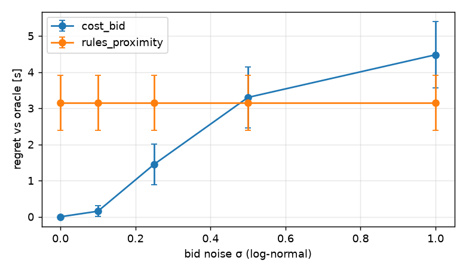

## S7 — Noisy cost estimates in `cost_bid` (bid × exp(σ·N(0,1)); bay x ∈ 1…7 m; 30 seeds)

| σ | cost_bid regret [s] | cost_bid same yielder as oracle | rules_proximity regret [s] | cost_bid success |
|---|---|---|---|---|
| 0.0 | 0.0 ± 0.0 | 100% | 3.2 ± 0.8 | 100.0% [98–100] |
| 0.1 | 0.2 ± 0.1 | 97% | 3.2 ± 0.8 | 100.0% [98–100] |
| 0.25 | 1.5 ± 0.6 | 86% | 3.2 ± 0.8 | 100.0% [98–100] |
| 0.5 | 3.3 ± 0.8 | 72% | 3.2 ± 0.8 | 100.0% [98–100] |
| 1.0 | 4.5 ± 0.9 | 62% | 3.2 ± 0.8 | 100.0% [98–100] |

## S8 — Comms stress (conflict-detection range × robot speed × loss × latency; 20 seeds)

**success rate [%]** (rows: detection range and v_max; columns: loss and latency)

`fixed_priority`

| geom                 |   loss 0.0, lat 0.05 |   loss 0.0, lat 0.5 |   loss 0.0, lat 2.0 |   loss 0.5, lat 0.05 |   loss 0.5, lat 0.5 |   loss 0.5, lat 2.0 |   loss 0.9, lat 0.05 |   loss 0.9, lat 0.5 |   loss 0.9, lat 2.0 |
|:---------------------|---------------------:|--------------------:|--------------------:|---------------------:|--------------------:|--------------------:|---------------------:|--------------------:|--------------------:|
| detect 1.5 m, v 0.26 |                  100 |                 100 |                 100 |                  100 |                 100 |                 100 |                  100 |                 100 |                 100 |
| detect 1.5 m, v 0.5  |                  100 |                 100 |                 100 |                  100 |                 100 |                 100 |                  100 |                 100 |                 100 |
| detect 3.0 m, v 0.26 |                  100 |                 100 |                 100 |                  100 |                 100 |                 100 |                   90 |                  90 |                 100 |
| detect 3.0 m, v 0.5  |                  100 |                 100 |                 100 |                  100 |                 100 |                 100 |                  100 |                  95 |                 100 |
| detect 6.0 m, v 0.26 |                  100 |                 100 |                 100 |                  100 |                 100 |                 100 |                  100 |                  95 |                  95 |
| detect 6.0 m, v 0.5  |                  100 |                 100 |                 100 |                  100 |                 100 |                 100 |                  100 |                  95 |                 100 |

`rules_default`

| geom                 |   loss 0.0, lat 0.05 |   loss 0.0, lat 0.5 |   loss 0.0, lat 2.0 |   loss 0.5, lat 0.05 |   loss 0.5, lat 0.5 |   loss 0.5, lat 2.0 |   loss 0.9, lat 0.05 |   loss 0.9, lat 0.5 |   loss 0.9, lat 2.0 |
|:---------------------|---------------------:|--------------------:|--------------------:|---------------------:|--------------------:|--------------------:|---------------------:|--------------------:|--------------------:|
| detect 1.5 m, v 0.26 |                  100 |                 100 |                 100 |                  100 |                 100 |                 100 |                  100 |                 100 |                 100 |
| detect 1.5 m, v 0.5  |                  100 |                 100 |                 100 |                  100 |                 100 |                 100 |                  100 |                 100 |                 100 |
| detect 3.0 m, v 0.26 |                  100 |                 100 |                 100 |                  100 |                 100 |                 100 |                   90 |                  90 |                 100 |
| detect 3.0 m, v 0.5  |                  100 |                 100 |                 100 |                  100 |                 100 |                 100 |                  100 |                  95 |                 100 |
| detect 6.0 m, v 0.26 |                  100 |                 100 |                 100 |                  100 |                 100 |                 100 |                  100 |                  95 |                  95 |
| detect 6.0 m, v 0.5  |                  100 |                 100 |                 100 |                  100 |                 100 |                 100 |                  100 |                  95 |                 100 |

`rules_proximity`

| geom                 |   loss 0.0, lat 0.05 |   loss 0.0, lat 0.5 |   loss 0.0, lat 2.0 |   loss 0.5, lat 0.05 |   loss 0.5, lat 0.5 |   loss 0.5, lat 2.0 |   loss 0.9, lat 0.05 |   loss 0.9, lat 0.5 |   loss 0.9, lat 2.0 |
|:---------------------|---------------------:|--------------------:|--------------------:|---------------------:|--------------------:|--------------------:|---------------------:|--------------------:|--------------------:|
| detect 1.5 m, v 0.26 |                  100 |                 100 |                 100 |                  100 |                 100 |                 100 |                   95 |                 100 |                 100 |
| detect 1.5 m, v 0.5  |                  100 |                 100 |                 100 |                  100 |                 100 |                 100 |                  100 |                 100 |                 100 |
| detect 3.0 m, v 0.26 |                  100 |                 100 |                 100 |                  100 |                 100 |                 100 |                  100 |                 100 |                  90 |
| detect 3.0 m, v 0.5  |                  100 |                 100 |                 100 |                  100 |                 100 |                 100 |                  100 |                 100 |                 100 |
| detect 6.0 m, v 0.26 |                  100 |                 100 |                 100 |                  100 |                 100 |                 100 |                  100 |                  95 |                  90 |
| detect 6.0 m, v 0.5  |                  100 |                 100 |                 100 |                  100 |                 100 |                 100 |                  100 |                 100 |                  95 |

`cost_bid`

| geom                 |   loss 0.0, lat 0.05 |   loss 0.0, lat 0.5 |   loss 0.0, lat 2.0 |   loss 0.5, lat 0.05 |   loss 0.5, lat 0.5 |   loss 0.5, lat 2.0 |   loss 0.9, lat 0.05 |   loss 0.9, lat 0.5 |   loss 0.9, lat 2.0 |
|:---------------------|---------------------:|--------------------:|--------------------:|---------------------:|--------------------:|--------------------:|---------------------:|--------------------:|--------------------:|
| detect 1.5 m, v 0.26 |                  100 |                 100 |                 100 |                  100 |                 100 |                 100 |                   95 |                 100 |                 100 |
| detect 1.5 m, v 0.5  |                  100 |                 100 |                 100 |                  100 |                 100 |                 100 |                  100 |                 100 |                 100 |
| detect 3.0 m, v 0.26 |                  100 |                 100 |                 100 |                  100 |                 100 |                 100 |                  100 |                 100 |                  90 |
| detect 3.0 m, v 0.5  |                  100 |                 100 |                 100 |                  100 |                 100 |                 100 |                  100 |                 100 |                 100 |
| detect 6.0 m, v 0.26 |                  100 |                 100 |                 100 |                  100 |                 100 |                 100 |                  100 |                 100 |                  95 |
| detect 6.0 m, v 0.5  |                  100 |                 100 |                 100 |                  100 |                 100 |                 100 |                   95 |                 100 |                  90 |

**collision rate [%]** (rows: detection range and v_max; columns: loss and latency)

`fixed_priority`

| geom                 |   loss 0.0, lat 0.05 |   loss 0.0, lat 0.5 |   loss 0.0, lat 2.0 |   loss 0.5, lat 0.05 |   loss 0.5, lat 0.5 |   loss 0.5, lat 2.0 |   loss 0.9, lat 0.05 |   loss 0.9, lat 0.5 |   loss 0.9, lat 2.0 |
|:---------------------|---------------------:|--------------------:|--------------------:|---------------------:|--------------------:|--------------------:|---------------------:|--------------------:|--------------------:|
| detect 1.5 m, v 0.26 |                    0 |                   0 |                   0 |                    0 |                   0 |                   0 |                    0 |                   0 |                   0 |
| detect 1.5 m, v 0.5  |                    0 |                   0 |                   0 |                    0 |                   0 |                   0 |                    0 |                   0 |                   0 |
| detect 3.0 m, v 0.26 |                    0 |                   0 |                   0 |                    0 |                   0 |                   0 |                    0 |                   0 |                   0 |
| detect 3.0 m, v 0.5  |                    0 |                   0 |                   0 |                    0 |                   0 |                   0 |                    0 |                   0 |                   0 |
| detect 6.0 m, v 0.26 |                    0 |                   0 |                   0 |                    0 |                   0 |                   0 |                    0 |                   0 |                   0 |
| detect 6.0 m, v 0.5  |                    0 |                   0 |                   0 |                    0 |                   0 |                   0 |                    0 |                   0 |                   0 |

`rules_default`

| geom                 |   loss 0.0, lat 0.05 |   loss 0.0, lat 0.5 |   loss 0.0, lat 2.0 |   loss 0.5, lat 0.05 |   loss 0.5, lat 0.5 |   loss 0.5, lat 2.0 |   loss 0.9, lat 0.05 |   loss 0.9, lat 0.5 |   loss 0.9, lat 2.0 |
|:---------------------|---------------------:|--------------------:|--------------------:|---------------------:|--------------------:|--------------------:|---------------------:|--------------------:|--------------------:|
| detect 1.5 m, v 0.26 |                    0 |                   0 |                   0 |                    0 |                   0 |                   0 |                    0 |                   0 |                   0 |
| detect 1.5 m, v 0.5  |                    0 |                   0 |                   0 |                    0 |                   0 |                   0 |                    0 |                   0 |                   0 |
| detect 3.0 m, v 0.26 |                    0 |                   0 |                   0 |                    0 |                   0 |                   0 |                    0 |                   0 |                   0 |
| detect 3.0 m, v 0.5  |                    0 |                   0 |                   0 |                    0 |                   0 |                   0 |                    0 |                   0 |                   0 |
| detect 6.0 m, v 0.26 |                    0 |                   0 |                   0 |                    0 |                   0 |                   0 |                    0 |                   0 |                   0 |
| detect 6.0 m, v 0.5  |                    0 |                   0 |                   0 |                    0 |                   0 |                   0 |                    0 |                   0 |                   0 |

`rules_proximity`

| geom                 |   loss 0.0, lat 0.05 |   loss 0.0, lat 0.5 |   loss 0.0, lat 2.0 |   loss 0.5, lat 0.05 |   loss 0.5, lat 0.5 |   loss 0.5, lat 2.0 |   loss 0.9, lat 0.05 |   loss 0.9, lat 0.5 |   loss 0.9, lat 2.0 |
|:---------------------|---------------------:|--------------------:|--------------------:|---------------------:|--------------------:|--------------------:|---------------------:|--------------------:|--------------------:|
| detect 1.5 m, v 0.26 |                    0 |                   0 |                   0 |                    0 |                   0 |                   0 |                    0 |                   0 |                   0 |
| detect 1.5 m, v 0.5  |                    0 |                   0 |                   0 |                    0 |                   0 |                   0 |                    0 |                   0 |                   0 |
| detect 3.0 m, v 0.26 |                    0 |                   0 |                   0 |                    0 |                   0 |                   0 |                    0 |                   0 |                   0 |
| detect 3.0 m, v 0.5  |                    0 |                   0 |                   0 |                    0 |                   0 |                   0 |                    0 |                   0 |                   0 |
| detect 6.0 m, v 0.26 |                    0 |                   0 |                   0 |                    0 |                   0 |                   0 |                    0 |                   0 |                   0 |
| detect 6.0 m, v 0.5  |                    0 |                   0 |                   0 |                    0 |                   0 |                   0 |                    0 |                   0 |                   0 |

`cost_bid`

| geom                 |   loss 0.0, lat 0.05 |   loss 0.0, lat 0.5 |   loss 0.0, lat 2.0 |   loss 0.5, lat 0.05 |   loss 0.5, lat 0.5 |   loss 0.5, lat 2.0 |   loss 0.9, lat 0.05 |   loss 0.9, lat 0.5 |   loss 0.9, lat 2.0 |
|:---------------------|---------------------:|--------------------:|--------------------:|---------------------:|--------------------:|--------------------:|---------------------:|--------------------:|--------------------:|
| detect 1.5 m, v 0.26 |                    0 |                   0 |                   0 |                    0 |                   0 |                   0 |                    0 |                   0 |                   0 |
| detect 1.5 m, v 0.5  |                    0 |                   0 |                   0 |                    0 |                   0 |                   0 |                    0 |                   0 |                   0 |
| detect 3.0 m, v 0.26 |                    0 |                   0 |                   0 |                    0 |                   0 |                   0 |                    0 |                   0 |                   0 |
| detect 3.0 m, v 0.5  |                    0 |                   0 |                   0 |                    0 |                   0 |                   0 |                    0 |                   0 |                   0 |
| detect 6.0 m, v 0.26 |                    0 |                   0 |                   0 |                    0 |                   0 |                   0 |                    0 |                   0 |                   0 |
| detect 6.0 m, v 0.5  |                    0 |                   0 |                   0 |                    0 |                   0 |                   0 |                    0 |                   0 |                   0 |

**pooled over all comms levels**

|                                             |   success |   collision |   deadlock |   both |
|:--------------------------------------------|----------:|------------:|-----------:|-------:|
| ('cost_bid', 'detect 1.5 m, v 0.26')        |      99.4 |           0 |        0.6 |    3.3 |
| ('cost_bid', 'detect 1.5 m, v 0.5')         |     100   |           0 |        0   |    0.6 |
| ('cost_bid', 'detect 3.0 m, v 0.26')        |      98.9 |           0 |        1.1 |    1.1 |
| ('cost_bid', 'detect 3.0 m, v 0.5')         |     100   |           0 |        0   |    3.3 |
| ('cost_bid', 'detect 6.0 m, v 0.26')        |      99.4 |           0 |        0.6 |    2.2 |
| ('cost_bid', 'detect 6.0 m, v 0.5')         |      98.3 |           0 |        1.7 |    3.9 |
| ('fixed_priority', 'detect 1.5 m, v 0.26')  |     100   |           0 |        0   |    2.2 |
| ('fixed_priority', 'detect 1.5 m, v 0.5')   |     100   |           0 |        0   |    0   |
| ('fixed_priority', 'detect 3.0 m, v 0.26')  |      97.8 |           0 |        2.2 |    2.2 |
| ('fixed_priority', 'detect 3.0 m, v 0.5')   |      99.4 |           0 |        0.6 |    0.6 |
| ('fixed_priority', 'detect 6.0 m, v 0.26')  |      98.9 |           0 |        1.1 |    3.3 |
| ('fixed_priority', 'detect 6.0 m, v 0.5')   |      99.4 |           0 |        0.6 |    7.8 |
| ('rules_default', 'detect 1.5 m, v 0.26')   |     100   |           0 |        0   |    2.2 |
| ('rules_default', 'detect 1.5 m, v 0.5')    |     100   |           0 |        0   |    0   |
| ('rules_default', 'detect 3.0 m, v 0.26')   |      97.8 |           0 |        2.2 |    2.2 |
| ('rules_default', 'detect 3.0 m, v 0.5')    |      99.4 |           0 |        0.6 |    0.6 |
| ('rules_default', 'detect 6.0 m, v 0.26')   |      98.9 |           0 |        1.1 |    3.3 |
| ('rules_default', 'detect 6.0 m, v 0.5')    |      99.4 |           0 |        0.6 |    7.8 |
| ('rules_proximity', 'detect 1.5 m, v 0.26') |      99.4 |           0 |        0.6 |    3.3 |
| ('rules_proximity', 'detect 1.5 m, v 0.5')  |     100   |           0 |        0   |    0.6 |
| ('rules_proximity', 'detect 3.0 m, v 0.26') |      98.9 |           0 |        1.1 |    1.1 |
| ('rules_proximity', 'detect 3.0 m, v 0.5')  |     100   |           0 |        0   |    3.3 |
| ('rules_proximity', 'detect 6.0 m, v 0.26') |      98.3 |           0 |        1.7 |    3.3 |
| ('rules_proximity', 'detect 6.0 m, v 0.5')  |      99.4 |           0 |        0.6 |    6.1 |

## S8b — Extreme comms (v_max 0.5 m/s; detection 1.5 | 6 m; loss 0.9–0.99; latency 2–8 s; 20 seeds)

|                                     |   success |   collision |   deadlock |   both_yielded |
|:------------------------------------|----------:|------------:|-----------:|---------------:|
| ('cost_bid', 1.5, 0.9, 2.0)         |       100 |           0 |          0 |              5 |
| ('cost_bid', 1.5, 0.9, 4.0)         |       100 |           0 |          0 |             15 |
| ('cost_bid', 1.5, 0.9, 8.0)         |        95 |           0 |          5 |             65 |
| ('cost_bid', 1.5, 0.97, 2.0)        |       100 |           0 |          0 |             15 |
| ('cost_bid', 1.5, 0.97, 4.0)        |       100 |           0 |          0 |             15 |
| ('cost_bid', 1.5, 0.97, 8.0)        |       100 |           0 |          0 |             30 |
| ('cost_bid', 1.5, 0.99, 2.0)        |       100 |           0 |          0 |             10 |
| ('cost_bid', 1.5, 0.99, 4.0)        |       100 |           0 |          0 |             10 |
| ('cost_bid', 1.5, 0.99, 8.0)        |       100 |           0 |          0 |             20 |
| ('cost_bid', 6.0, 0.9, 2.0)         |        90 |           0 |         10 |             20 |
| ('cost_bid', 6.0, 0.9, 4.0)         |        95 |           0 |          5 |             25 |
| ('cost_bid', 6.0, 0.9, 8.0)         |       100 |           0 |          0 |             45 |
| ('cost_bid', 6.0, 0.97, 2.0)        |       100 |           0 |          0 |              5 |
| ('cost_bid', 6.0, 0.97, 4.0)        |       100 |           0 |          0 |             25 |
| ('cost_bid', 6.0, 0.97, 8.0)        |       100 |           0 |          0 |             15 |
| ('cost_bid', 6.0, 0.99, 2.0)        |       100 |           0 |          0 |              0 |
| ('cost_bid', 6.0, 0.99, 4.0)        |       100 |           0 |          0 |              5 |
| ('cost_bid', 6.0, 0.99, 8.0)        |       100 |           0 |          0 |             10 |
| ('fixed_priority', 1.5, 0.9, 2.0)   |       100 |           0 |          0 |              0 |
| ('fixed_priority', 1.5, 0.9, 4.0)   |       100 |           0 |          0 |             10 |
| ('fixed_priority', 1.5, 0.9, 8.0)   |       100 |           0 |          0 |             55 |
| ('fixed_priority', 1.5, 0.97, 2.0)  |       100 |           0 |          0 |             25 |
| ('fixed_priority', 1.5, 0.97, 4.0)  |       100 |           0 |          0 |             35 |
| ('fixed_priority', 1.5, 0.97, 8.0)  |       100 |           0 |          0 |             40 |
| ('fixed_priority', 1.5, 0.99, 2.0)  |       100 |           0 |          0 |             15 |
| ('fixed_priority', 1.5, 0.99, 4.0)  |       100 |           0 |          0 |             10 |
| ('fixed_priority', 1.5, 0.99, 8.0)  |       100 |           0 |          0 |             20 |
| ('fixed_priority', 6.0, 0.9, 2.0)   |       100 |           0 |          0 |             35 |
| ('fixed_priority', 6.0, 0.9, 4.0)   |        85 |           0 |         15 |             45 |
| ('fixed_priority', 6.0, 0.9, 8.0)   |       100 |           0 |          0 |             65 |
| ('fixed_priority', 6.0, 0.97, 2.0)  |       100 |           0 |          0 |             10 |
| ('fixed_priority', 6.0, 0.97, 4.0)  |       100 |           0 |          0 |             20 |
| ('fixed_priority', 6.0, 0.97, 8.0)  |       100 |           0 |          0 |             20 |
| ('fixed_priority', 6.0, 0.99, 2.0)  |       100 |           0 |          0 |              5 |
| ('fixed_priority', 6.0, 0.99, 4.0)  |       100 |           0 |          0 |              5 |
| ('fixed_priority', 6.0, 0.99, 8.0)  |       100 |           0 |          0 |             10 |
| ('rules_default', 1.5, 0.9, 2.0)    |       100 |           0 |          0 |              0 |
| ('rules_default', 1.5, 0.9, 4.0)    |       100 |           0 |          0 |             10 |
| ('rules_default', 1.5, 0.9, 8.0)    |       100 |           0 |          0 |             55 |
| ('rules_default', 1.5, 0.97, 2.0)   |       100 |           0 |          0 |             25 |
| ('rules_default', 1.5, 0.97, 4.0)   |       100 |           0 |          0 |             35 |
| ('rules_default', 1.5, 0.97, 8.0)   |       100 |           0 |          0 |             40 |
| ('rules_default', 1.5, 0.99, 2.0)   |       100 |           0 |          0 |             15 |
| ('rules_default', 1.5, 0.99, 4.0)   |       100 |           0 |          0 |             10 |
| ('rules_default', 1.5, 0.99, 8.0)   |       100 |           0 |          0 |             20 |
| ('rules_default', 6.0, 0.9, 2.0)    |       100 |           0 |          0 |             35 |
| ('rules_default', 6.0, 0.9, 4.0)    |        85 |           0 |         15 |             45 |
| ('rules_default', 6.0, 0.9, 8.0)    |       100 |           0 |          0 |             65 |
| ('rules_default', 6.0, 0.97, 2.0)   |       100 |           0 |          0 |             10 |
| ('rules_default', 6.0, 0.97, 4.0)   |       100 |           0 |          0 |             20 |
| ('rules_default', 6.0, 0.97, 8.0)   |       100 |           0 |          0 |             20 |
| ('rules_default', 6.0, 0.99, 2.0)   |       100 |           0 |          0 |              5 |
| ('rules_default', 6.0, 0.99, 4.0)   |       100 |           0 |          0 |              5 |
| ('rules_default', 6.0, 0.99, 8.0)   |       100 |           0 |          0 |             10 |
| ('rules_proximity', 1.5, 0.9, 2.0)  |       100 |           0 |          0 |              5 |
| ('rules_proximity', 1.5, 0.9, 4.0)  |       100 |           0 |          0 |             15 |
| ('rules_proximity', 1.5, 0.9, 8.0)  |        95 |           0 |          5 |             65 |
| ('rules_proximity', 1.5, 0.97, 2.0) |       100 |           0 |          0 |             15 |
| ('rules_proximity', 1.5, 0.97, 4.0) |       100 |           0 |          0 |             15 |
| ('rules_proximity', 1.5, 0.97, 8.0) |       100 |           0 |          0 |             30 |
| ('rules_proximity', 1.5, 0.99, 2.0) |       100 |           0 |          0 |             10 |
| ('rules_proximity', 1.5, 0.99, 4.0) |       100 |           0 |          0 |             10 |
| ('rules_proximity', 1.5, 0.99, 8.0) |       100 |           0 |          0 |             20 |
| ('rules_proximity', 6.0, 0.9, 2.0)  |        95 |           0 |          5 |             15 |
| ('rules_proximity', 6.0, 0.9, 4.0)  |        95 |           0 |          5 |             25 |
| ('rules_proximity', 6.0, 0.9, 8.0)  |       100 |           0 |          0 |             45 |
| ('rules_proximity', 6.0, 0.97, 2.0) |       100 |           0 |          0 |              5 |
| ('rules_proximity', 6.0, 0.97, 4.0) |       100 |           0 |          0 |             25 |
| ('rules_proximity', 6.0, 0.97, 8.0) |       100 |           0 |          0 |             15 |
| ('rules_proximity', 6.0, 0.99, 2.0) |       100 |           0 |          0 |              0 |
| ('rules_proximity', 6.0, 0.99, 4.0) |       100 |           0 |          0 |              5 |
| ('rules_proximity', 6.0, 0.99, 8.0) |       100 |           0 |          0 |             10 |

## S9 — Clarke-pivot payments under misreports (bay x ∈ {2,4,6}; u_B ∈ {1,3}; 60 seeds)

10080 episodes, 10080 successful, 0 collisions. Failed episodes are excluded from the utility tables.

Gain from misreporting = deviator utility minus its utility in the same encounter with everyone truthful (mean ± 95% CI; for `AB` the sum over both robots). "Profitable" = share of encounters with gain > 0.01 s.

| who misreports | k | yielder changed | no transfers, predicted | previous rule, predicted | Clarke, predicted | Clarke, profitable | Clarke, realized | total cost change [s] |
|---|---|---|---|---|---|---|---|---|
| A | 0.25 | 17% | -2.35 ± 0.54 | 7.54 ± 1.76 | -1.47 ± 0.34 | 0% | -2.06 ± 0.48 | 1.47 ± 0.34 |
| A | 0.5 | 0% | 0.00 ± 0.00 | -0.00 ± 0.00 | 0.00 ± 0.00 | 0% | 0.00 ± 0.00 | 0.00 ± 0.00 |
| A | 0.75 | 0% | 0.00 ± 0.00 | -0.00 ± 0.00 | 0.00 ± 0.00 | 0% | 0.00 ± 0.00 | 0.00 ± 0.00 |
| A | 0.9 | 0% | 0.00 ± 0.00 | 0.00 ± 0.00 | 0.00 ± 0.00 | 0% | 0.00 ± 0.00 | 0.00 ± 0.00 |
| A | 1.1 | 1% | 0.09 ± 0.08 | -0.15 ± 0.15 | -0.01 ± 0.01 | 0% | 0.02 ± 0.02 | 0.01 ± 0.01 |
| A | 1.25 | 2% | 0.23 ± 0.20 | -0.31 ± 0.22 | -0.04 ± 0.04 | 0% | 0.01 ± 0.04 | 0.04 ± 0.04 |
| A | 1.5 | 10% | 1.98 ± 0.71 | -1.36 ± 0.44 | -0.75 ± 0.29 | 0% | -0.52 ± 0.24 | 0.75 ± 0.29 |
| A | 2.0 | 19% | 3.98 ± 0.96 | -3.36 ± 0.74 | -2.04 ± 0.52 | 0% | -1.59 ± 0.44 | 2.04 ± 0.52 |
| A | 4.0 | 28% | 4.74 ± 0.99 | -9.68 ± 1.96 | -3.99 ± 1.10 | 0% | -3.33 ± 1.04 | 3.99 ± 1.10 |
| AB | 0.25 | 0% | 0.00 ± 0.00 | 21.52 ± 1.14 | 7.42 ± 0.82 | 100% | 7.42 ± 0.82 | 0.00 ± 0.00 |
| AB | 0.5 | 0% | 0.00 ± 0.00 | 14.35 ± 0.76 | 4.94 ± 0.55 | 100% | 4.94 ± 0.55 | 0.00 ± 0.00 |
| AB | 0.75 | 0% | 0.00 ± 0.00 | 7.17 ± 0.38 | 2.47 ± 0.27 | 100% | 2.47 ± 0.27 | 0.00 ± 0.00 |
| AB | 0.9 | 0% | 0.00 ± 0.00 | 2.87 ± 0.15 | 0.99 ± 0.11 | 100% | 0.99 ± 0.11 | 0.00 ± 0.00 |
| AB | 1.1 | 0% | 0.00 ± 0.00 | -2.87 ± 0.15 | -0.99 ± 0.11 | 0% | -0.99 ± 0.11 | 0.00 ± 0.00 |
| AB | 1.25 | 0% | 0.00 ± 0.00 | -7.17 ± 0.38 | -2.47 ± 0.27 | 0% | -2.47 ± 0.27 | 0.00 ± 0.00 |
| AB | 1.5 | 0% | 0.00 ± 0.00 | -14.35 ± 0.76 | -4.94 ± 0.55 | 0% | -4.94 ± 0.55 | 0.00 ± 0.00 |
| AB | 2.0 | 0% | 0.00 ± 0.00 | -28.70 ± 1.52 | -9.89 ± 1.10 | 0% | -9.89 ± 1.10 | 0.00 ± 0.00 |
| AB | 4.0 | 0% | 0.00 ± 0.00 | -86.09 ± 4.56 | -29.66 ± 3.29 | 0% | -29.66 ± 3.29 | 0.00 ± 0.00 |
| B | 0.25 | 28% | -8.73 ± 1.91 | -1.20 ± 1.16 | -3.99 ± 1.10 | 0% | -4.86 ± 1.23 | 3.99 ± 1.10 |
| B | 0.5 | 19% | -6.02 ± 1.46 | -0.47 ± 0.65 | -2.04 ± 0.52 | 0% | -2.50 ± 0.60 | 2.04 ± 0.52 |
| B | 0.75 | 4% | -0.72 ± 0.45 | 0.68 ± 0.24 | -0.14 ± 0.10 | 0% | -0.25 ± 0.14 | 0.14 ± 0.10 |
| B | 0.9 | 1% | -0.09 ± 0.09 | 0.31 ± 0.13 | -0.01 ± 0.01 | 0% | -0.03 ± 0.03 | 0.01 ± 0.01 |
| B | 1.1 | 0% | 0.00 ± 0.00 | -0.18 ± 0.04 | 0.00 ± 0.00 | 0% | 0.00 ± 0.00 | 0.00 ± 0.00 |
| B | 1.25 | 0% | 0.00 ± 0.00 | -0.45 ± 0.10 | 0.00 ± 0.00 | 0% | 0.00 ± 0.00 | 0.00 ± 0.00 |
| B | 1.5 | 0% | 0.00 ± 0.00 | -0.91 ± 0.20 | 0.00 ± 0.00 | 0% | 0.00 ± 0.00 | 0.00 ± 0.00 |
| B | 2.0 | 0% | 0.00 ± 0.00 | -1.82 ± 0.41 | 0.00 ± 0.00 | 0% | 0.00 ± 0.00 | 0.00 ± 0.00 |
| B | 4.0 | 17% | 0.88 ± 0.20 | -42.98 ± 8.58 | -1.47 ± 0.34 | 0% | -0.85 ± 0.20 | 1.47 ± 0.34 |

Truthful reports, by B's urgency. Revenue = Σ payments to the bank (the mechanism never runs a deficit). "Worse than fixed priority" = share of encounters where the robot's predicted utility, payment included, is below its utility under fixed priority without transfers (B always yields).

| u_B | n | true total cost [s] | revenue [s] | revenue / total cost | max payment [s] | A worse than fixed priority | B worse than fixed priority |
|---|---|---|---|---|---|---|---|
| 1 | 180 | 21.2 ± 0.7 | 9.3 ± 1.6 | 44% | 31.2 | 100% | 0% |
| 3 | 180 | 36.2 ± 2.5 | 10.5 ± 1.5 | 29% | 31.2 | 100% | 0% |

## S10 — Repeated encounters (50 sequences × 20 encounters; random bay x ∈ [1,7] m and B delay U[0,8] s)

Per-encounter costs come from forced-yielder runs; each rule is then applied to the same encounter sequence. `credit_lλ` yields the robot minimising total delay + λ·(own cumulative delay − other's).

| Rule | total delay / sequence [s] | extra vs cost-optimal | Jain (cumulative delays) | \|cum_A − cum_B\| [s] | A yields / 20 |
|---|---|---|---|---|---|
| `fixed_priority` | 649.7 ± 11.0 | +27.1% | 0.754 ± 0.020 | 372.0 ± 22.6 | 0.0 |
| `cost` | 511.3 ± 6.8 | +0.0% | 0.927 ± 0.020 | 127.8 ± 22.6 | 11.9 |
| `alternate` | 624.9 ± 9.4 | +22.3% | 0.992 ± 0.002 | 47.1 ± 8.2 | 10.0 |
| `credit_l0.25` | 552.7 ± 10.1 | +8.1% | 0.997 ± 0.001 | 25.3 ± 3.8 | 9.9 |
| `credit_l0.5` | 580.8 ± 10.8 | +13.6% | 0.998 ± 0.000 | 19.8 ± 3.6 | 10.0 |
| `credit_l1.0` | 602.1 ± 11.4 | +17.8% | 0.999 ± 0.000 | 17.5 ± 3.1 | 10.5 |
| `credit_l2.0` | 614.7 ± 11.0 | +20.3% | 0.999 ± 0.000 | 17.9 ± 3.0 | 10.5 |
