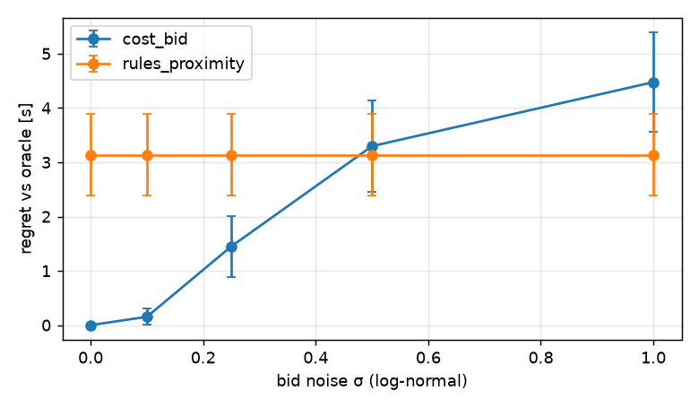
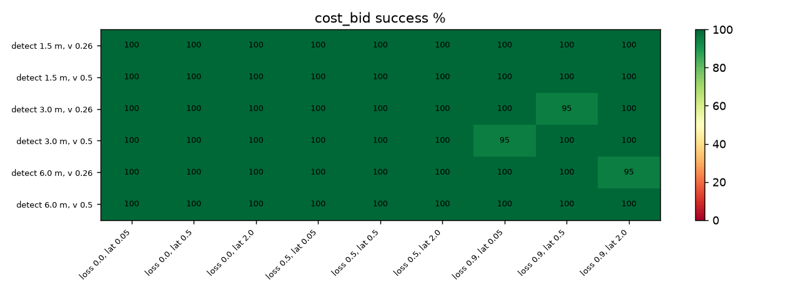

## S7 — Noisy cost estimates in `cost_bid` (bid × exp(σ·N(0,1)); bay x ∈ 1…7 m; 30 seeds)

| σ | cost_bid regret [s] | cost_bid same yielder as oracle | rules_proximity regret [s] | cost_bid success |
|---|---|---|---|---|
| 0.0 | 0.0 ± 0.0 | 100% | 3.1 ± 0.8 | 100.0% [98–100] |
| 0.1 | 0.2 ± 0.1 | 97% | 3.1 ± 0.8 | 100.0% [98–100] |
| 0.25 | 1.5 ± 0.6 | 86% | 3.1 ± 0.8 | 100.0% [98–100] |
| 0.5 | 3.3 ± 0.8 | 72% | 3.1 ± 0.8 | 100.0% [98–100] |
| 1.0 | 4.5 ± 0.9 | 62% | 3.1 ± 0.8 | 100.0% [98–100] |

## S8 — Comms stress (conflict-detection range × robot speed × loss × latency; 20 seeds)

**success rate [%]** (rows: detection range and v_max; columns: loss and latency)

`fixed_priority`

| geom                 |   loss 0.0, lat 0.05 |   loss 0.0, lat 0.5 |   loss 0.0, lat 2.0 |   loss 0.5, lat 0.05 |   loss 0.5, lat 0.5 |   loss 0.5, lat 2.0 |   loss 0.9, lat 0.05 |   loss 0.9, lat 0.5 |   loss 0.9, lat 2.0 |
|:---------------------|---------------------:|--------------------:|--------------------:|---------------------:|--------------------:|--------------------:|---------------------:|--------------------:|--------------------:|
| detect 1.5 m, v 0.26 |                  100 |                 100 |                 100 |                  100 |                 100 |                 100 |                  100 |                 100 |                 100 |
| detect 1.5 m, v 0.5  |                  100 |                 100 |                 100 |                  100 |                 100 |                 100 |                  100 |                 100 |                 100 |
| detect 3.0 m, v 0.26 |                  100 |                 100 |                 100 |                  100 |                 100 |                 100 |                  100 |                 100 |                 100 |
| detect 3.0 m, v 0.5  |                  100 |                 100 |                 100 |                  100 |                 100 |                 100 |                   95 |                  95 |                 100 |
| detect 6.0 m, v 0.26 |                  100 |                 100 |                 100 |                  100 |                 100 |                 100 |                  100 |                 100 |                  90 |
| detect 6.0 m, v 0.5  |                  100 |                 100 |                 100 |                  100 |                 100 |                  95 |                  100 |                 100 |                  75 |

`rules_default`

| geom                 |   loss 0.0, lat 0.05 |   loss 0.0, lat 0.5 |   loss 0.0, lat 2.0 |   loss 0.5, lat 0.05 |   loss 0.5, lat 0.5 |   loss 0.5, lat 2.0 |   loss 0.9, lat 0.05 |   loss 0.9, lat 0.5 |   loss 0.9, lat 2.0 |
|:---------------------|---------------------:|--------------------:|--------------------:|---------------------:|--------------------:|--------------------:|---------------------:|--------------------:|--------------------:|
| detect 1.5 m, v 0.26 |                  100 |                 100 |                 100 |                  100 |                 100 |                 100 |                  100 |                 100 |                 100 |
| detect 1.5 m, v 0.5  |                  100 |                 100 |                 100 |                  100 |                 100 |                 100 |                  100 |                 100 |                 100 |
| detect 3.0 m, v 0.26 |                  100 |                 100 |                 100 |                  100 |                 100 |                 100 |                  100 |                 100 |                 100 |
| detect 3.0 m, v 0.5  |                  100 |                 100 |                 100 |                  100 |                 100 |                 100 |                   95 |                  95 |                 100 |
| detect 6.0 m, v 0.26 |                  100 |                 100 |                 100 |                  100 |                 100 |                 100 |                  100 |                 100 |                  90 |
| detect 6.0 m, v 0.5  |                  100 |                 100 |                 100 |                  100 |                 100 |                  95 |                  100 |                 100 |                  75 |

`rules_proximity`

| geom                 |   loss 0.0, lat 0.05 |   loss 0.0, lat 0.5 |   loss 0.0, lat 2.0 |   loss 0.5, lat 0.05 |   loss 0.5, lat 0.5 |   loss 0.5, lat 2.0 |   loss 0.9, lat 0.05 |   loss 0.9, lat 0.5 |   loss 0.9, lat 2.0 |
|:---------------------|---------------------:|--------------------:|--------------------:|---------------------:|--------------------:|--------------------:|---------------------:|--------------------:|--------------------:|
| detect 1.5 m, v 0.26 |                  100 |                 100 |                 100 |                  100 |                 100 |                 100 |                  100 |                 100 |                 100 |
| detect 1.5 m, v 0.5  |                  100 |                 100 |                 100 |                  100 |                 100 |                 100 |                  100 |                 100 |                 100 |
| detect 3.0 m, v 0.26 |                  100 |                 100 |                 100 |                  100 |                 100 |                 100 |                  100 |                  95 |                 100 |
| detect 3.0 m, v 0.5  |                  100 |                 100 |                 100 |                  100 |                 100 |                 100 |                   95 |                 100 |                 100 |
| detect 6.0 m, v 0.26 |                  100 |                 100 |                 100 |                  100 |                 100 |                 100 |                  100 |                 100 |                  95 |
| detect 6.0 m, v 0.5  |                  100 |                 100 |                 100 |                  100 |                 100 |                  95 |                  100 |                 100 |                 100 |

`cost_bid`

| geom                 |   loss 0.0, lat 0.05 |   loss 0.0, lat 0.5 |   loss 0.0, lat 2.0 |   loss 0.5, lat 0.05 |   loss 0.5, lat 0.5 |   loss 0.5, lat 2.0 |   loss 0.9, lat 0.05 |   loss 0.9, lat 0.5 |   loss 0.9, lat 2.0 |
|:---------------------|---------------------:|--------------------:|--------------------:|---------------------:|--------------------:|--------------------:|---------------------:|--------------------:|--------------------:|
| detect 1.5 m, v 0.26 |                  100 |                 100 |                 100 |                  100 |                 100 |                 100 |                  100 |                 100 |                 100 |
| detect 1.5 m, v 0.5  |                  100 |                 100 |                 100 |                  100 |                 100 |                 100 |                  100 |                 100 |                 100 |
| detect 3.0 m, v 0.26 |                  100 |                 100 |                 100 |                  100 |                 100 |                 100 |                  100 |                  95 |                 100 |
| detect 3.0 m, v 0.5  |                  100 |                 100 |                 100 |                  100 |                 100 |                 100 |                   95 |                 100 |                 100 |
| detect 6.0 m, v 0.26 |                  100 |                 100 |                 100 |                  100 |                 100 |                 100 |                  100 |                 100 |                  95 |
| detect 6.0 m, v 0.5  |                  100 |                 100 |                 100 |                  100 |                 100 |                 100 |                  100 |                 100 |                 100 |

**collision rate [%]** (rows: detection range and v_max; columns: loss and latency)

`fixed_priority`

| geom                 |   loss 0.0, lat 0.05 |   loss 0.0, lat 0.5 |   loss 0.0, lat 2.0 |   loss 0.5, lat 0.05 |   loss 0.5, lat 0.5 |   loss 0.5, lat 2.0 |   loss 0.9, lat 0.05 |   loss 0.9, lat 0.5 |   loss 0.9, lat 2.0 |
|:---------------------|---------------------:|--------------------:|--------------------:|---------------------:|--------------------:|--------------------:|---------------------:|--------------------:|--------------------:|
| detect 1.5 m, v 0.26 |                    0 |                   0 |                   0 |                    0 |                   0 |                   0 |                    0 |                   0 |                   0 |
| detect 1.5 m, v 0.5  |                    0 |                   0 |                   0 |                    0 |                   0 |                   0 |                    0 |                   0 |                   0 |
| detect 3.0 m, v 0.26 |                    0 |                   0 |                   0 |                    0 |                   0 |                   0 |                    0 |                   0 |                   0 |
| detect 3.0 m, v 0.5  |                    0 |                   0 |                   0 |                    0 |                   0 |                   0 |                    0 |                   0 |                   0 |
| detect 6.0 m, v 0.26 |                    0 |                   0 |                   0 |                    0 |                   0 |                   0 |                    0 |                   0 |                   0 |
| detect 6.0 m, v 0.5  |                    0 |                   0 |                   0 |                    0 |                   0 |                   0 |                    0 |                   0 |                   0 |

`rules_default`

| geom                 |   loss 0.0, lat 0.05 |   loss 0.0, lat 0.5 |   loss 0.0, lat 2.0 |   loss 0.5, lat 0.05 |   loss 0.5, lat 0.5 |   loss 0.5, lat 2.0 |   loss 0.9, lat 0.05 |   loss 0.9, lat 0.5 |   loss 0.9, lat 2.0 |
|:---------------------|---------------------:|--------------------:|--------------------:|---------------------:|--------------------:|--------------------:|---------------------:|--------------------:|--------------------:|
| detect 1.5 m, v 0.26 |                    0 |                   0 |                   0 |                    0 |                   0 |                   0 |                    0 |                   0 |                   0 |
| detect 1.5 m, v 0.5  |                    0 |                   0 |                   0 |                    0 |                   0 |                   0 |                    0 |                   0 |                   0 |
| detect 3.0 m, v 0.26 |                    0 |                   0 |                   0 |                    0 |                   0 |                   0 |                    0 |                   0 |                   0 |
| detect 3.0 m, v 0.5  |                    0 |                   0 |                   0 |                    0 |                   0 |                   0 |                    0 |                   0 |                   0 |
| detect 6.0 m, v 0.26 |                    0 |                   0 |                   0 |                    0 |                   0 |                   0 |                    0 |                   0 |                   0 |
| detect 6.0 m, v 0.5  |                    0 |                   0 |                   0 |                    0 |                   0 |                   0 |                    0 |                   0 |                   0 |

`rules_proximity`

| geom                 |   loss 0.0, lat 0.05 |   loss 0.0, lat 0.5 |   loss 0.0, lat 2.0 |   loss 0.5, lat 0.05 |   loss 0.5, lat 0.5 |   loss 0.5, lat 2.0 |   loss 0.9, lat 0.05 |   loss 0.9, lat 0.5 |   loss 0.9, lat 2.0 |
|:---------------------|---------------------:|--------------------:|--------------------:|---------------------:|--------------------:|--------------------:|---------------------:|--------------------:|--------------------:|
| detect 1.5 m, v 0.26 |                    0 |                   0 |                   0 |                    0 |                   0 |                   0 |                    0 |                   0 |                   0 |
| detect 1.5 m, v 0.5  |                    0 |                   0 |                   0 |                    0 |                   0 |                   0 |                    0 |                   0 |                   0 |
| detect 3.0 m, v 0.26 |                    0 |                   0 |                   0 |                    0 |                   0 |                   0 |                    0 |                   0 |                   0 |
| detect 3.0 m, v 0.5  |                    0 |                   0 |                   0 |                    0 |                   0 |                   0 |                    0 |                   0 |                   0 |
| detect 6.0 m, v 0.26 |                    0 |                   0 |                   0 |                    0 |                   0 |                   0 |                    0 |                   0 |                   0 |
| detect 6.0 m, v 0.5  |                    0 |                   0 |                   0 |                    0 |                   0 |                   0 |                    0 |                   0 |                   0 |

`cost_bid`

| geom                 |   loss 0.0, lat 0.05 |   loss 0.0, lat 0.5 |   loss 0.0, lat 2.0 |   loss 0.5, lat 0.05 |   loss 0.5, lat 0.5 |   loss 0.5, lat 2.0 |   loss 0.9, lat 0.05 |   loss 0.9, lat 0.5 |   loss 0.9, lat 2.0 |
|:---------------------|---------------------:|--------------------:|--------------------:|---------------------:|--------------------:|--------------------:|---------------------:|--------------------:|--------------------:|
| detect 1.5 m, v 0.26 |                    0 |                   0 |                   0 |                    0 |                   0 |                   0 |                    0 |                   0 |                   0 |
| detect 1.5 m, v 0.5  |                    0 |                   0 |                   0 |                    0 |                   0 |                   0 |                    0 |                   0 |                   0 |
| detect 3.0 m, v 0.26 |                    0 |                   0 |                   0 |                    0 |                   0 |                   0 |                    0 |                   0 |                   0 |
| detect 3.0 m, v 0.5  |                    0 |                   0 |                   0 |                    0 |                   0 |                   0 |                    0 |                   0 |                   0 |
| detect 6.0 m, v 0.26 |                    0 |                   0 |                   0 |                    0 |                   0 |                   0 |                    0 |                   0 |                   0 |
| detect 6.0 m, v 0.5  |                    0 |                   0 |                   0 |                    0 |                   0 |                   0 |                    0 |                   0 |                   0 |

**pooled over all comms levels**

|                                             |   success |   collision |   deadlock |   both |
|:--------------------------------------------|----------:|------------:|-----------:|-------:|
| ('cost_bid', 'detect 1.5 m, v 0.26')        |     100   |           0 |        0   |    1.7 |
| ('cost_bid', 'detect 1.5 m, v 0.5')         |     100   |           0 |        0   |    0   |
| ('cost_bid', 'detect 3.0 m, v 0.26')        |      99.4 |           0 |        0.6 |    0.6 |
| ('cost_bid', 'detect 3.0 m, v 0.5')         |      99.4 |           0 |        0.6 |    0.6 |
| ('cost_bid', 'detect 6.0 m, v 0.26')        |      99.4 |           0 |        0.6 |    2.2 |
| ('cost_bid', 'detect 6.0 m, v 0.5')         |     100   |           0 |        0   |    1.1 |
| ('fixed_priority', 'detect 1.5 m, v 0.26')  |     100   |           0 |        0   |    1.1 |
| ('fixed_priority', 'detect 1.5 m, v 0.5')   |     100   |           0 |        0   |    0   |
| ('fixed_priority', 'detect 3.0 m, v 0.26')  |     100   |           0 |        0   |    1.1 |
| ('fixed_priority', 'detect 3.0 m, v 0.5')   |      98.9 |           0 |        1.1 |    1.1 |
| ('fixed_priority', 'detect 6.0 m, v 0.26')  |      98.9 |           0 |        1.1 |    1.7 |
| ('fixed_priority', 'detect 6.0 m, v 0.5')   |      96.7 |           0 |        3.3 |    2.8 |
| ('rules_default', 'detect 1.5 m, v 0.26')   |     100   |           0 |        0   |    1.1 |
| ('rules_default', 'detect 1.5 m, v 0.5')    |     100   |           0 |        0   |    0   |
| ('rules_default', 'detect 3.0 m, v 0.26')   |     100   |           0 |        0   |    1.1 |
| ('rules_default', 'detect 3.0 m, v 0.5')    |      98.9 |           0 |        1.1 |    1.1 |
| ('rules_default', 'detect 6.0 m, v 0.26')   |      98.9 |           0 |        1.1 |    1.7 |
| ('rules_default', 'detect 6.0 m, v 0.5')    |      96.7 |           0 |        3.3 |    2.8 |
| ('rules_proximity', 'detect 1.5 m, v 0.26') |     100   |           0 |        0   |    1.7 |
| ('rules_proximity', 'detect 1.5 m, v 0.5')  |     100   |           0 |        0   |    0   |
| ('rules_proximity', 'detect 3.0 m, v 0.26') |      99.4 |           0 |        0.6 |    0.6 |
| ('rules_proximity', 'detect 3.0 m, v 0.5')  |      99.4 |           0 |        0.6 |    0.6 |
| ('rules_proximity', 'detect 6.0 m, v 0.26') |      99.4 |           0 |        0.6 |    3.3 |
| ('rules_proximity', 'detect 6.0 m, v 0.5')  |      99.4 |           0 |        0.6 |    2.8 |

## S8b — Extreme comms (v_max 0.5 m/s; detection 1.5 | 6 m; loss 0.9–0.99; latency 2–8 s; 20 seeds)

|                                     |   success |   collision |   deadlock |   both_yielded |
|:------------------------------------|----------:|------------:|-----------:|---------------:|
| ('cost_bid', 1.5, 0.9, 2.0)         |       100 |           0 |          0 |              0 |
| ('cost_bid', 1.5, 0.9, 4.0)         |       100 |           0 |          0 |              0 |
| ('cost_bid', 1.5, 0.9, 8.0)         |        85 |           0 |         15 |             65 |
| ('cost_bid', 1.5, 0.97, 2.0)        |       100 |           0 |          0 |              5 |
| ('cost_bid', 1.5, 0.97, 4.0)        |       100 |           0 |          0 |              0 |
| ('cost_bid', 1.5, 0.97, 8.0)        |       100 |           0 |          0 |             30 |
| ('cost_bid', 1.5, 0.99, 2.0)        |        95 |           0 |          5 |             10 |
| ('cost_bid', 1.5, 0.99, 4.0)        |        95 |           0 |          5 |             10 |
| ('cost_bid', 1.5, 0.99, 8.0)        |        95 |           0 |          5 |             20 |
| ('cost_bid', 6.0, 0.9, 2.0)         |       100 |           0 |          0 |             10 |
| ('cost_bid', 6.0, 0.9, 4.0)         |        95 |           0 |          5 |             25 |
| ('cost_bid', 6.0, 0.9, 8.0)         |       100 |           0 |          0 |             45 |
| ('cost_bid', 6.0, 0.97, 2.0)        |       100 |           0 |          0 |              5 |
| ('cost_bid', 6.0, 0.97, 4.0)        |       100 |           0 |          0 |             20 |
| ('cost_bid', 6.0, 0.97, 8.0)        |       100 |           0 |          0 |             10 |
| ('cost_bid', 6.0, 0.99, 2.0)        |       100 |           0 |          0 |              0 |
| ('cost_bid', 6.0, 0.99, 4.0)        |        95 |           5 |          0 |              5 |
| ('cost_bid', 6.0, 0.99, 8.0)        |       100 |           0 |          0 |             10 |
| ('fixed_priority', 1.5, 0.9, 2.0)   |       100 |           0 |          0 |              0 |
| ('fixed_priority', 1.5, 0.9, 4.0)   |       100 |           0 |          0 |              0 |
| ('fixed_priority', 1.5, 0.9, 8.0)   |        95 |           0 |          5 |             55 |
| ('fixed_priority', 1.5, 0.97, 2.0)  |       100 |           0 |          0 |              5 |
| ('fixed_priority', 1.5, 0.97, 4.0)  |       100 |           0 |          0 |              0 |
| ('fixed_priority', 1.5, 0.97, 8.0)  |       100 |           0 |          0 |             40 |
| ('fixed_priority', 1.5, 0.99, 2.0)  |        95 |           0 |          5 |             10 |
| ('fixed_priority', 1.5, 0.99, 4.0)  |        95 |           0 |          5 |             10 |
| ('fixed_priority', 1.5, 0.99, 8.0)  |        95 |           0 |          5 |             20 |
| ('fixed_priority', 6.0, 0.9, 2.0)   |        75 |           0 |         25 |             15 |
| ('fixed_priority', 6.0, 0.9, 4.0)   |        90 |           0 |         10 |             35 |
| ('fixed_priority', 6.0, 0.9, 8.0)   |        95 |           5 |          0 |             55 |
| ('fixed_priority', 6.0, 0.97, 2.0)  |       100 |           0 |          0 |              5 |
| ('fixed_priority', 6.0, 0.97, 4.0)  |       100 |           0 |          0 |             15 |
| ('fixed_priority', 6.0, 0.97, 8.0)  |       100 |           0 |          0 |             20 |
| ('fixed_priority', 6.0, 0.99, 2.0)  |       100 |           0 |          0 |              0 |
| ('fixed_priority', 6.0, 0.99, 4.0)  |        95 |           5 |          0 |              5 |
| ('fixed_priority', 6.0, 0.99, 8.0)  |       100 |           0 |          0 |             10 |
| ('rules_default', 1.5, 0.9, 2.0)    |       100 |           0 |          0 |              0 |
| ('rules_default', 1.5, 0.9, 4.0)    |       100 |           0 |          0 |              0 |
| ('rules_default', 1.5, 0.9, 8.0)    |        95 |           0 |          5 |             55 |
| ('rules_default', 1.5, 0.97, 2.0)   |       100 |           0 |          0 |              5 |
| ('rules_default', 1.5, 0.97, 4.0)   |       100 |           0 |          0 |              0 |
| ('rules_default', 1.5, 0.97, 8.0)   |       100 |           0 |          0 |             40 |
| ('rules_default', 1.5, 0.99, 2.0)   |        95 |           0 |          5 |             10 |
| ('rules_default', 1.5, 0.99, 4.0)   |        95 |           0 |          5 |             10 |
| ('rules_default', 1.5, 0.99, 8.0)   |        95 |           0 |          5 |             20 |
| ('rules_default', 6.0, 0.9, 2.0)    |        75 |           0 |         25 |             15 |
| ('rules_default', 6.0, 0.9, 4.0)    |        90 |           0 |         10 |             35 |
| ('rules_default', 6.0, 0.9, 8.0)    |        95 |           5 |          0 |             55 |
| ('rules_default', 6.0, 0.97, 2.0)   |       100 |           0 |          0 |              5 |
| ('rules_default', 6.0, 0.97, 4.0)   |       100 |           0 |          0 |             15 |
| ('rules_default', 6.0, 0.97, 8.0)   |       100 |           0 |          0 |             20 |
| ('rules_default', 6.0, 0.99, 2.0)   |       100 |           0 |          0 |              0 |
| ('rules_default', 6.0, 0.99, 4.0)   |        95 |           5 |          0 |              5 |
| ('rules_default', 6.0, 0.99, 8.0)   |       100 |           0 |          0 |             10 |
| ('rules_proximity', 1.5, 0.9, 2.0)  |       100 |           0 |          0 |              0 |
| ('rules_proximity', 1.5, 0.9, 4.0)  |       100 |           0 |          0 |              0 |
| ('rules_proximity', 1.5, 0.9, 8.0)  |        85 |           0 |         15 |             65 |
| ('rules_proximity', 1.5, 0.97, 2.0) |       100 |           0 |          0 |              5 |
| ('rules_proximity', 1.5, 0.97, 4.0) |       100 |           0 |          0 |              0 |
| ('rules_proximity', 1.5, 0.97, 8.0) |       100 |           0 |          0 |             30 |
| ('rules_proximity', 1.5, 0.99, 2.0) |        95 |           0 |          5 |             10 |
| ('rules_proximity', 1.5, 0.99, 4.0) |        95 |           0 |          5 |             10 |
| ('rules_proximity', 1.5, 0.99, 8.0) |        95 |           0 |          5 |             20 |
| ('rules_proximity', 6.0, 0.9, 2.0)  |       100 |           0 |          0 |             15 |
| ('rules_proximity', 6.0, 0.9, 4.0)  |        95 |           0 |          5 |             25 |
| ('rules_proximity', 6.0, 0.9, 8.0)  |       100 |           0 |          0 |             45 |
| ('rules_proximity', 6.0, 0.97, 2.0) |       100 |           0 |          0 |              5 |
| ('rules_proximity', 6.0, 0.97, 4.0) |       100 |           0 |          0 |             20 |
| ('rules_proximity', 6.0, 0.97, 8.0) |       100 |           0 |          0 |             10 |
| ('rules_proximity', 6.0, 0.99, 2.0) |       100 |           0 |          0 |              0 |
| ('rules_proximity', 6.0, 0.99, 4.0) |        95 |           5 |          0 |              5 |
| ('rules_proximity', 6.0, 0.99, 8.0) |       100 |           0 |          0 |             10 |

## S9 — Payments for honest bids (B reports k × its true bid; bay x ∈ {2,4,6}; 60 seeds)

Utilities are in seconds of delay. With VCG (Clarke pivot) payments, the robot that proceeds pays the yielder's *reported* bid to the bank; the yielder pays nothing. Truthful bidding is then a dominant strategy (in expectation over the cost model).

| k | B yields | total delay [s] | B utility, no transfers [s] | Δ vs truthful | B utility, VCG [s] | Δ vs truthful | bank revenue [s] |
|---|---|---|---|---|---|---|---|
| 1.0 | 33% | 24.4 ± 0.6 | -8.8 | 0.0 ± 0.0 | -23.4 | 0.0 ± 0.0 | 21.2 |
| 1.5 | 33% | 24.4 ± 0.6 | -8.8 | 0.0 ± 0.0 | -23.4 | 0.0 ± 0.0 | 24.5 |
| 2.0 | 0% | 29.3 ± 1.0 | -7.8 | 1.0 ± 0.2 | -33.1 | -9.7 ± 2.0 | 25.3 |
| 4.0 | 0% | 29.3 ± 1.0 | -7.8 | 1.0 ± 0.2 | -33.1 | -9.7 ± 2.0 | 25.3 |

## S10 — Repeated encounters (50 sequences × 20 encounters; random bay x ∈ [1,7] m and B delay U[0,8] s)

Per-encounter costs come from forced-yielder runs; each rule is then applied to the same encounter sequence. `credit_lλ` yields the robot minimising total delay + λ·(own cumulative delay − other's).

| Rule | total delay / sequence [s] | extra vs cost-optimal | Jain (cumulative delays) | \|cum_A − cum_B\| [s] | A yields / 20 |
|---|---|---|---|---|---|
| `fixed_priority` | 635.4 ± 11.0 | +27.9% | 0.746 ± 0.020 | 371.7 ± 22.6 | 0.0 |
| `cost` | 496.9 ± 6.8 | +0.0% | 0.924 ± 0.021 | 127.7 ± 22.6 | 11.9 |
| `alternate` | 610.6 ± 9.4 | +23.0% | 0.992 ± 0.002 | 47.1 ± 8.2 | 10.0 |
| `credit_l0.25` | 538.3 ± 10.1 | +8.3% | 0.997 ± 0.001 | 25.3 ± 3.8 | 9.9 |
| `credit_l0.5` | 566.3 ± 10.7 | +14.0% | 0.998 ± 0.000 | 19.8 ± 3.6 | 10.0 |
| `credit_l1.0` | 587.1 ± 11.6 | +18.2% | 0.999 ± 0.000 | 17.8 ± 3.1 | 10.5 |
| `credit_l2.0` | 600.4 ± 10.9 | +20.9% | 0.999 ± 0.000 | 17.9 ± 3.0 | 10.5 |
